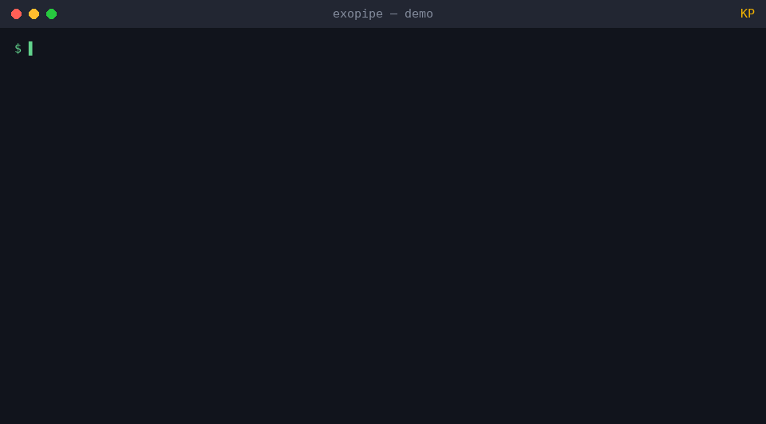

# Transit Recovery Bench


Built by Kanak Prabhakar

Measure how preprocessing changes recovery of injected periodic signals in a cached TESS light curve.



## Features and architecture
Read Lightkurve FITS time and flux, then normalize the finite cadences. Inject a known periodic box. Compare raw, Savitzky–Golay (`lightkurve.flatten`) and segment-wise median filtering, all searched with one identical Astropy BLS grid (periods 1–5 d, durations 0.08/0.12/0.16 d).


## Layout
| Path | What |
|---|---|
| `exopipe/bench/bench.py` | the benchmark (importable: `inject`, `trials`, `DEPTHS`) |
| `exopipe/bench/test_transit.py` | unit tests |
| `data/bench/` | cached TESS FITS and its source/licence note |
| `docs/bench/` | this guide, PRD, TRD, edge cases, presentation |
| `docs/bench/results/` | latest `recovery.csv`, printed results, test logs |

## Installation and usage
From the repository root, in a Python 3.11+ virtual environment:

```sh
python -m pip install -r exopipe/bench/requirements.txt
python -m exopipe.bench.bench data/bench/tic261136679-sector01.fits recovery.csv
python -m pytest -q exopipe/bench
```

After setup the analysis runs offline.

## Benchmark protocol
- The FITS checksum is fixed and written into every CSV row.
- Three periods (2.17, 3.43, 4.37 d) × seven non-zero depths (50 ppm to 1%) give 21 trials per method.
- Depth 0 rows are null controls and are excluded from the counts.
- Every method sees the same injected realization (same epoch), so a lucky phase cannot favour one method.
- A recovery means the BLS best period is within 1% of the injected period.
- Runtime includes detrending and the search.

**Why the grid changed (2026-11-21).** The first version only used depths of 0.1%, 0.3% and 1%. Every method scored 9/9, so the benchmark could not tell the methods apart. TIC 261136679 (π Mensae) is bright and quiet. Adding 50–500 ppm depths shows where preprocessing starts to matter.

| Injected depth | Raw | Flattened | Robust median |
|---:|---:|---:|---:|
| 50 ppm | 0/3 | 0/3 | 0/3 |
| 100 ppm | 0/3 | 0/3 | 1/3 |
| 200 ppm | 3/3 | 0/3 | 3/3 |
| 500 ppm | 3/3 | 3/3 | 3/3 |
| 1000 ppm | 3/3 | 3/3 | 3/3 |
| 3000 ppm | 3/3 | 3/3 | 3/3 |
| 10000 ppm | 3/3 | 3/3 | 3/3 |
| **Total** | **15/21** | **12/21** | **16/21** |

**Reading it:**
- `flatten(window_length=101)` spans about 3.4 h at a 2-minute cadence, close to the injected 2.9 h transit. So it most likely fits part of the dip as "trend" and removes it. That would explain why it loses every 200 ppm case (not separately proven: a window-length sweep would confirm it).
- The robust median keeps them. The raw curve also keeps them, because this one sector has little slow variability.
- On a more variable star, raw would be expected to suffer. That is the next experiment.

## Limitations and roadmap
- Three periods per depth is a small sample. Treat the counts as directional, not as a completeness curve.
- Period agreement alone cannot prove astrophysical origin.
- One quiet star and one sector cannot establish survey completeness.
- Next: a variable star, more periods per depth, and a detection-significance threshold checked against the null rows.

## Resume line
Accomplished a reproducible preprocessing benchmark for TESS transit search, as measured by injected-transit recovery within 1% of the true period across 21 trials per method on real π Men sector-1 photometry (robust median 16/21, raw 15/21, default flatten 12/21; flatten lost all three 200 ppm transits). Done by building a paired injection-recovery harness with one shared BLS grid.

## Credits
[exopipe](https://github.com/Kanak234/exopipe), [Lightkurve](https://lightkurve.github.io/lightkurve/), [Astropy](https://www.astropy.org/), [SciPy](https://scipy.org/), [pytest](https://pytest.org/). TESS data via MAST; see `data/bench/SOURCES.md`.

See PRD.md, TRD.md and edge-cases.md for the design, and results/ for the latest runs.
