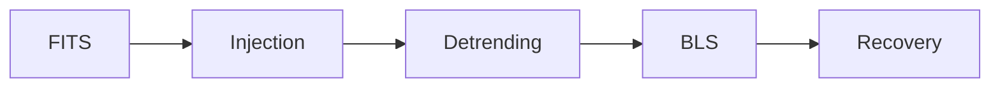

# Transit Recovery Bench


Built by Kanak Prabhakar

Measure how preprocessing changes recovery of injected periodic signals in a cached TESS light curve.

## Features and architecture
Read Lightkurve FITS time and flux, normalize finite cadences, inject a known periodic box, compare raw, Savitzky–Golay and segment-wise median filtering on an identical Astropy BLS search grid.



## Installation and usage
From the existing exopipe root, run `python -m pip install -r exopipe/bench/requirements.txt` in a Python 3.11+ virtual environment. After setup the analysis runs offline.

```sh
python -m exopipe.bench.bench cached.fits recovery.csv
python -m pytest -q exopipe/bench
python -m exopipe.bench.bench cached.fits recovery.csv
```

## Benchmark protocol
Run from the existing repository root. Use the same FITS checksum for all methods. Three periods and three nonzero depths yield nine period-recovery trials per method. Count a recovery within 1% of injected period. Rows with zero depth are null controls and are excluded from recovery counts. They reuse the same underlying curve. Runtime includes detrending and search.

| Method | Recovered within 1% | Trials |
|---|---:|---:|
| Raw | 9 | 9 |
| Flattened | 9 | 9 |
| Robust median | 9 | 9 |

## Limitations and roadmap
Period agreement alone cannot prove astrophysical origin. One sector cannot establish survey completeness. Next add independent null curves and detection thresholds.

## Resume
Accomplished reproducible transit recovery as measured by TBD of nine injected periods recovered by doing a paired BLS comparison across three detrending methods. Use the method counts printed by the benchmark.

For the supplied dataset use `python -m exopipe.bench.bench exopipe/bench/sample/tic261136679-sector01.fits recovery.csv`. The trial-level measurements and the mission data source are included. The dependency stack may warn about an optional pixel-model package outside this workflow.

## Credits
[exopipe](https://github.com/Kanak234/exopipe), [Lightkurve](https://lightkurve.github.io/lightkurve/), [Astropy](https://www.astropy.org/), [SciPy](https://scipy.org/), [pytest](https://pytest.org/).

## Publish
The ZIP contains the full source tree based on upstream commit 47fa2d4957f1533d7f8caeaaca644d387c7003fa. To publish, copy the exopipe/bench directory into your existing Git clone and add the module link from the packaged root README. Run the command below in the clone from PowerShell 7 or Bash.
```sh
git add README.md exopipe/bench && git -c user.name="Kanak Prabhakar" -c user.email="kanakprabhakar72@gmail.com" commit -m "Add transit recovery benchmark" && git push
```


## Presentation

1. I added exopipe/bench/bench.py inside the existing exopipe package.
2. I read cached TESS observations and injected periodic dips into identical cadences for each method.
3. I compared raw, flattened and median-filtered signals using Astropy BLS.
4. I tested phase wrapping, short curves and strong-signal recovery in test_transit.py.
5. I exported recovered periods, errors, timing and the FITS checksum to recovery.csv.

**Main limitation.** One target and period agreement alone cannot establish population-level completeness or a calibrated false-positive rate.


See edge-cases.md for tested inputs and tests-output.txt for actual Windows pytest output.
